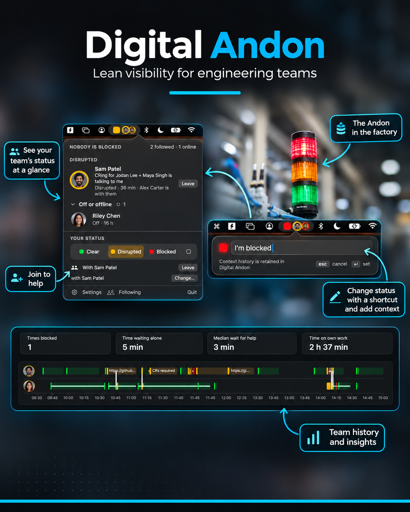

# Digital Andon

A digital andon cord for a software team. Everyone's status is one of three lights, from the menu bar or a keyboard shortcut:

- **Clear** (green): work is progressing as expected.
- **Disrupted** (amber): work is progressing slower due to an unexpected complication.
- **Blocked** (red): work cannot continue without external attention.

The people who follow them see it straight away in their Mac menu bar, and someone **joins** them. Everything is logged, and the web app shows the whole team live and how everyone's lights have moved over time.

## Quick start

Install: `brew install --cask JamesDHW/tap/digital-andon`.

**Note**: sign-in to this service is restricted to Theodo domains.



Your light is the squircle. After it comes one avatar per person you follow, whose ring is their light, most urgent first. There is no limit: past four people the avatars overlap. Photos are everyone's Google profile picture. A red that has waited 10 minutes with nobody joining them breathes. Off hides you everywhere: your squircle disappears, and you vanish from everyone else's bar. Locking your screen switches you Off at once, and unlocking puts your light back as it was (Off stays Off). Closing your laptop counts as Off too: once your Mac has been gone for 2 minutes, the server switches your light off, so nobody is left showing Clear (or Blocked) after going home. With **Bright colours** on (Settings → Display; on by default), XDR displays (recent MacBook Pros, Pro Display XDR) draw amber and red brighter than white while the Mac is plugged in. That makes macOS run the backlight harder, so on battery or in Low Power Mode they're drawn at normal brightness, as they always are with Bright colours off; green always is. Nothing redraws on a timer: breathing is a Core Animation fade. (Drawn at 8× from the same geometry the app uses.)

| Shortcut | Does |
|---|---|
| ⌃⌥↑ / ⌃⌥↓ | Step your light up (Clear → Disrupted → Blocked) or down (Blocked → Disrupted → Clear) |
| ⌃⌥O | Off (hidden from everyone) and back on |
| ⌃⌥S | Set your context: one line of what's going on (Enter sets, empty clears, Esc cancels) |
| ⌃⌥J | Join someone: with exactly one person Disrupted or Blocked, joins them; otherwise pick anyone working with ↑↓ and Enter, most urgent first |

The dropdown has a button for each light too. Any change shows on your own screen at once and reaches the team once it has settled for 3 seconds, so Blocked ↓↓ is sent as one Blocked → Clear. Going Blocked opens the context box straight away (leave it empty if you like). Your context stays through Disrupted, Blocked and Off, and clears when you go back to Clear. Context history is kept. In the dropdown, context is cut to two lines: hover for all of it, click it (or "More") to expand it, and any links in it get their own buttons that open in your browser. On the web board, links in the hover card are clickable too. The context box, the join picker and Settings all open inside the popover under the menu bar icon.

**Joining.** Anyone working has a **Join** button in the dropdown, prominent for Disrupted and Blocked, and Disrupted and Blocked notifications have one too. Joining someone Clear works the same way, so time spent with people who barely use Digital Andon is still logged. Joining makes you Disrupted, with the context "with <name>", and puts your face just behind theirs everywhere: the menu bar, the dropdown and the web app. For the person you joined, you're simply with them: your face is tucked behind their own squircle, you're left out of their people list, and their status shows "James is with you · 12 min". Only the helper can leave; the person being helped ends it by going Clear. Seeing red with an amber helper behind it means someone is on it; red alone means nobody is yet. A red someone has joined stops breathing, its reminder is cancelled, and it sorts behind reds nobody has reached. Several people can join the same person; joining a helper joins the person they're with, so there are never chains. You're with one person at a time: joining someone else leaves the first. When either of you changes to Clear or Off (including locking your screen or closing the lid), the join ends; someone joined while Clear stays joined until they change and the helper's light goes back to what it was before they joined. Leave does the same. Every join and leave is logged, so the time from a red to its first join (the response time) is in the export.

All shortcuts can be changed in Settings. By default only a red notifies, once, with one reminder after 10 minutes if they are still blocked. The banner goes away as soon as they leave red. "Colours only" turns every banner and sound off.

## What's in the repo

```
backend/   Cloudflare Worker + one Durable Object per team (TypeScript, architecture-rules)
  src/domain        pure decisions: pull the cord, statuses
  src/application   use cases over injected ports: socket commands, follows, Google sign-in, history, admin
  src/adapters      SQLite stores, Web Crypto, Resend/console email
  src/http          JSON endpoints        src/protocol  the socket contract shared with the app
  src/runtime       Worker entry, Durable Object, WebSockets (composition root)
  web/              the web app (React + Tailwind, built by Vite into web/dist and served by the Worker)
  scripts/          seed a local team, drive fake teammates
  test/             vitest against node:sqlite, the same SQLite dialect Durable Objects use
app/       macOS menu bar app (Swift)
  AndonKit/         Swift package: models, wire protocol, state, ranking, menu bar model, notification policy (+ XCTest)
  Andon/            AppKit + SwiftUI app: status item, dropdown, shortcuts, notifications, onboarding, settings
  project.yml       XcodeGen spec (the .xcodeproj is generated, not committed)
scripts/   build-release.sh (sign, notarise, dmg, appcast), update-homebrew-tap.sh
homebrew/  cask template
.github/   CI, backend deploy, app release
```

Both halves follow the [architecture-rules](https://github.com/JamesDHW/architecture-rules) style: errors returned as values (`T | AndonError` in TypeScript, `Result<T, AndonError>` in Swift), only one error-adapter file that catches, no `else`, readonly data, constants in `*.constants.ts` / `*Constants.swift`, small single-concept files. The backend is checked by `architecture-check`; the Swift side mirrors the rules by convention plus `.swiftlint.yml`.

---

## Running it locally

### Prerequisites

```bash
# Backend
brew install node@24 pnpm      # Node 24+ is required by architecture-rules
# App
xcode-select --install          # and Xcode 16.3 or later from the App Store, opened once
brew install xcodegen
```

### 1. Start the backend

```bash
cd backend
pnpm install
pnpm dev                        # wrangler dev with DEV_MODE=true → http://localhost:8787 (the Durable Object runs locally)
# optional: cp .dev.vars.example .dev.vars to set BOOTSTRAP_ADMIN_EMAIL and a Google client for trying sign-in
```

In a second terminal, create a team: you (James, the admin) plus four teammates you follow.

```bash
cd backend
pnpm seed
# → prints ANDON_API_URL and ANDON_DEV_TOKEN for the app
```

### 2. Run the app against it

```bash
cd app
xcodegen generate
open Andon.xcodeproj
```

In Xcode: **Product → Scheme → Edit Scheme… → Run → Arguments**, tick `ANDON_API_URL` and `ANDON_DEV_TOKEN` and paste the token from `pnpm seed`. Press ⌘R. The lights appear in your menu bar, with no onboarding.

### 3. Play the teammates

```bash
cd backend
pnpm fake-member Priya red "Prod deploy blocked by a failing migration"   # you get a banner; Priya's ring turns red
pnpm fake-member Tom amber                                                # no banner (amber is quiet by default)
pnpm fake-member Priya green          # her banner is withdrawn and her ring goes green
pnpm fake-member Tom off              # Tom disappears from your menu bar
pnpm fake-member Aisha watch          # print every socket message the team sends
```

To try onboarding instead, untick the two variables and sign in with an email code: the 6-digit code is printed in the `pnpm dev` log because no email key is set locally. For Google sign-in locally, add a Google client to `.dev.vars` (see `.dev.vars.example`).

### 4. Work on the web app

`pnpm dev` builds the web app once and serves it at http://localhost:8787. For instant reloads while editing `web/`, also run `pnpm dev:web` and open http://localhost:5173: it proxies the API to `pnpm dev`.

---

## Testing

### Automated

```bash
# Backend: types, your architecture rules, and 29 tests (domain, use cases, SQL adapters, HTTP endpoints)
cd backend && pnpm run check

# AndonKit: protocol (against JSON captured from the real backend), state, ranking, menu bar model, notification policy
cd app && swift test --package-path AndonKit

# The app itself builds unsigned in CI
cd app && xcodegen generate && xcodebuild -scheme Andon -configuration Debug CODE_SIGNING_ALLOWED=NO build
```

CI (`.github/workflows/ci.yml`) runs all three on every push and pull request.

### Manual checks before a release

Use two Macs, or one Mac plus `pnpm fake-member`:

1. **Install:** the dmg opens on a Mac that has never run Digital Andon, with no Gatekeeper warning.
2. **Join:** click **Continue with Google** with an account on an allowed domain. Your Google photo appears on your lead's bar within seconds.
3. **Follow:** open **Following** (the person icon at the bottom of the dropdown), type to find someone and switch them on; switch someone off and they stay where they are until you reopen the page. Sign in on a second Mac: the same follow list is there. (You can also follow from "Everyone else", or unfollow by right-clicking a row.)
4. **Blocked:** click Blocked in the dropdown. Your squircle turns red at once; about 3 seconds later your lead's bar shows your avatar ringed in red, plus a banner.
5. **Breathing:** leave it red for 10 minutes. Your squircle and your avatar on the lead's bar start to breathe.
6. **Reminder:** pull red again and ignore it. One reminder arrives after the configured time (set 2 minutes in Settings to test), and nothing after that.
7. **Context:** ⌃⌥S, type, Enter. The lead sees it under your name. Go Off and back: it's still there. Go Clear: it's gone.
8. **Colours only:** switch it on in Settings → Notifications. A red changes the bar but makes no banner.
9. **Off:** ⌃⌥O. Your squircle disappears and you vanish from the lead's bar. ⌃⌥O again brings you back as Clear.
10. **Resolve:** ⌃⌥↓ until Clear. Your ring turns green and the lead's banner is withdrawn, with no new notification.
11. **Offline:** close a lid while red. The red stays (faded) on the lead's bar for about 2 minutes, then goes off. When the lid opens, the Mac reconnects by itself, showing Off until you pick a light.
12. **Update:** tag a newer version. The running app offers it via Sparkle and relaunches.
13. **Shortcuts:** remap ⌃⌥S in Settings. The new one works and survives a relaunch.

---

## Deploying the backend (Cloudflare)

A team is small, so it runs comfortably on the Workers free plan (Durable Objects with SQLite storage are included).

One-time setup:

```bash
cd backend
pnpm exec wrangler login
pnpm exec wrangler secret put BOOTSTRAP_ADMIN_EMAIL   # your email: signing in with it makes you admin
pnpm exec wrangler secret put GOOGLE_CLIENT_SECRET     # from the Google OAuth client below
# edit wrangler.toml [vars]: GOOGLE_CLIENT_ID, ALLOWED_EMAIL_DOMAINS (e.g. "theodo.com")
pnpm run deploy                                         # → https://andon.<your-subdomain>.workers.dev
```

Then open `https://andon.<your-subdomain>.workers.dev/` and sign in with Google using the bootstrap address. Allowed domains can be changed later under Settings.

**Google sign-in** needs no Google Workspace admin: an OAuth client in any Google Cloud project works for every Google account.

1. In [Google Cloud Console](https://console.cloud.google.com/), create a project (e.g. "Digital Andon").
2. **Google Auth Platform → Branding:** app name "Digital Andon", your email as support and developer contact. **Audience:** External, then **Publish app**. Only the basic `openid email profile` scopes are used, so Google doesn't review it.
3. **Clients → Create client:** type **Web application**, authorised redirect URI `https://andon.<your-subdomain>.workers.dev/auth/google/callback` (add `http://localhost:8787/auth/google/callback` for local development).
4. Put the client ID in `wrangler.toml` as `GOOGLE_CLIENT_ID` and the secret in `wrangler secret put GOOGLE_CLIENT_SECRET`.

Anyone whose verified Google email is on an allowed domain can then join on their own, from the Mac app or the web app, with their Google name and photo. Photos always come from Google and are refreshed at each sign-in; people can change their name in Settings, not their photo. If a company's Workspace blocks unknown apps, its admin has to allow this client; otherwise nothing is needed.

**Fallback:** 6-digit email codes still work in the Mac app. Codes are sent through [Resend](https://resend.com) if `RESEND_API_KEY` is set (with `EMAIL_FROM` on a domain verified there); without it they only appear in `wrangler tail`.

**Ongoing:** `.github/workflows/deploy-backend.yml` checks and deploys on every push to `main` that touches `backend/`. It needs secrets `CLOUDFLARE_API_TOKEN` (the "Edit Cloudflare Workers" template) and `CLOUDFLARE_ACCOUNT_ID` in the GitHub environment `backend`.

---

## Releasing the app

Non-technical people install from a dmg, so it must be signed and notarised; Homebrew also stopped accepting unsigned casks in September 2026.

### One-time setup

1. **Apple Developer Program**, ideally your company's organisation account. Ask an admin for:
   - a **Developer ID Application** certificate, exported as a `.p12` with a password
   - an **App Store Connect API key** with the Developer role (for `notarytool`): the `.p8` file, its key ID and the issuer ID
2. **Sparkle update keys:** after one local build, run `generate_keys` from `app/build/DerivedData/SourcePackages/artifacts/sparkle/Sparkle/bin/` (or from the Sparkle release zip). It prints the public key; export the private key with `generate_keys -x private.key`.
3. **`app/Config/Andon.xcconfig`:** set `ANDON_BUNDLE_ID` (e.g. `uk.co.theodo.andon`), `DEVELOPMENT_TEAM`, `ANDON_DEFAULT_SERVER` (your Worker URL), `ANDON_APPCAST_URL` (`https:/$()/github.com/<org>/digital-andon/releases/latest/download/appcast.xml`) and `ANDON_SPARKLE_PUBLIC_KEY`.
4. **GitHub secrets** (environment `app`): `APPLE_CERTIFICATE_P12_BASE64` (`base64 -i cert.p12 | pbcopy`), `APPLE_CERTIFICATE_PASSWORD`, `APPLE_TEAM_ID`, `NOTARY_KEY_ID`, `NOTARY_ISSUER_ID`, `NOTARY_KEY_P8_BASE64`, `SPARKLE_PRIVATE_KEY`.
5. **Optional Homebrew tap:** create `<org>/homebrew-tap`, then set repository variable `HOMEBREW_TAP=<org>/homebrew-tap` and secret `HOMEBREW_TAP_TOKEN` (a fine-grained token with contents write on that repo only).
6. Set `DOWNLOAD_URL` in `backend/wrangler.toml` to `https://github.com/<org>/digital-andon/releases/latest/download/Digital-Andon.dmg`, so `https://andon.<…>.workers.dev/download` always serves the latest version.

### Each release

```bash
git tag v0.1.0
git push origin v0.1.0
```

`release.yml` builds, signs with hardened runtime, makes `Digital-Andon.dmg`, notarises and staples it, writes `appcast.xml`, attaches both to a GitHub release, and updates the tap. Check the result on a clean Mac:

```bash
spctl --assess --type open --context context:primary-signature -v Digital-Andon.dmg   # "accepted, source=Notarized Developer ID"
```

`scripts/build-release.sh` runs the same steps locally on a Mac when the same variables are exported.

### How the team installs it

- **Everyone:** open `https://andon.<…>.workers.dev/download`, drag Digital Andon to Applications, open it and click **Continue with Google**. Updates arrive automatically.
- **Developers, optionally:** `brew install --cask <org>/tap/digital-andon`.

---

## The web app

Everyone on the team signs in with Google at `https://andon.<…>.workers.dev/`. No admin has to add them: an allowed email domain is enough, and nobody else can see anything.

- **Team** (everyone): a live board of every face, ringed in its light, Blocked first, with anyone who has joined them tucked behind. Hover a section title for what the light means, or a face for the name, context and how long; click to open their timeline.
- **Timeline** (everyone, today by default): Blocked, Disrupted and Clear bands. Time Blocked with nobody there is a thicker, darker red, and a helper's face marks the moment they joined someone (dimmed where they left, so leaving before someone is unblocked shows). There's a line per person running back in time from their face. Pick people (the ones you follow by default) and a window (presets or any start and end). Weekends are greyed, and the axis shows hours or days to fit. Above it: how many blocks, the time blocked, the time waiting alone, the median wait for help and how many waited alone over 10 minutes. The address holds the people and window, so a view can be shared as a link.
- **Context switching** (everyone): one person's day. They're in the bottom swim lane and everyone they joined in the window has a lane above, each showing that person's context over time. A line runs through whoever they were with at each moment, so every switch is a jump between lanes; tiles count the people, the joins, and the time with others against their own work.
- **Export** (admins): the event log as CSV, filtered by people and time: every change of light and context, and every join and leave (with who was joined). `GET /team/events?format=csv&from=…&to=…&memberIds=…` with an admin token returns the same.
- **Settings** (admins): team name, allowed email domains, and removing members.

## Troubleshooting

- **The lights are grey and faint:** the app isn't connected. The dropdown says why, and it reconnects with back-off, immediately after the Mac wakes.
- **No banners:** check System Settings → Notifications → Digital Andon, and that "Colours only" is off in Settings → Notifications. Digital Andon also respects Focus.
- **A shortcut does nothing:** another app may own it. Remap it in Digital Andon Settings → Shortcuts.
- **"Sign in again":** the device was removed by an admin, or its token was revoked. Use the email code to sign back in.
